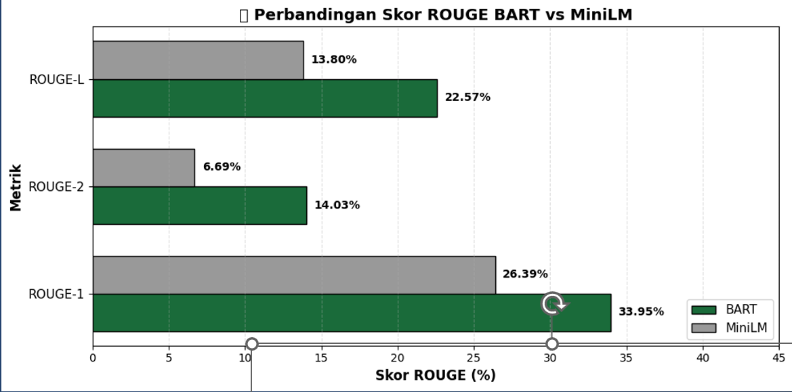
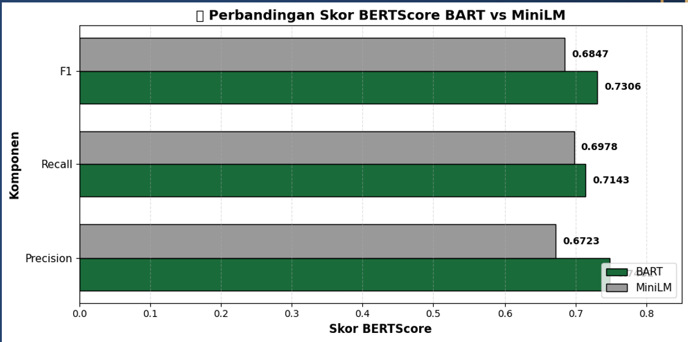

# 🧠 Comparative Analysis of BART and MiniLM in Indonesian Multi-Document Abstractive Summarization

[-0284c7?style=flat-square)](https://github.com/mursyidproject/indonesian-multidoc-summarization-bart-minilm)
[](#dataset-distribution)
[](#repository-structure)

An end-to-end Natural Language Processing (NLP) research project and interactive web application evaluating the quality-efficiency trade-off between a fine-tuned BART sequence-to-sequence architecture and a pseudo-abstractive MiniLM sentence-embedding approach for Indonesian multi-document news summarization.

---

## 📋 Research Overview & Methodology
Multi-document summarization condenses multiple news articles covering the same event into a single coherent summary.
- Models Evaluated:
  - BART: Fine-tuned directly on Indonesian multi-document news clusters.
  - MiniLM: Utilized via a pseudo-abstractive pipeline powered by dense sentence embeddings.
- Data Split: 600 news clusters split into 80% Training (480 clusters) and 20% Testing (120 clusters).
- Interactive Prototype: Built a modular Python web application powered by Gradio (`app.py`) for real-time multi-document summarization and comparative evaluation.

---

## 📊 Dataset Distribution
The corpus comprises 3,000 Indonesian news articles scraped from two major national portals (Kompas.com and Detik.com) between January 2026 and March 2026, grouped into 600 topic-aligned clusters (5 articles per cluster):

| News Portal | Topic Category | Total Articles | Total Clusters |
| :--- | :--- | :---: | :---: |
| Kompas.com | Economy | 750 | 150 |
| Kompas.com | Politics | 750 | 150 |
| Detik.com | Economy | 750 | 150 |
| Detik.com | Politics | 750 | 150 |
| Total | All Categories | 3,000 | 600 |

---

## 📈 Experimental Results & Evaluation

### 1. Quantitative Metrics (120 Test Clusters Average)
| Evaluation Metric | Fine-Tuned BART | MiniLM (Pseudo-Abstractive) |
| :--- | :---: | :---: |
| ROUGE-1 | 33.95% | 26.39% |
| ROUGE-2 | 14.03% | 6.69% |
| ROUGE-L | 22.57% | 13.80% |
| BERTScore Precision | 0.7482 | 0.6723 |
| BERTScore Recall | 0.7143 | 0.6978 |
| BERTScore F1 | 0.7306 | 0.6847 |
| Human Evaluation (30 Respondents) | 4.23 / 5.00 | 4.18 / 5.00 |

(Note: On peak sample clusters, BART achieved up to 57.39% ROUGE-1, 44.00% ROUGE-2, and 48.86% ROUGE-L, compared to MiniLM's 33.71%, 15.25%, and 21.91%).

### 2. Visual Comparison Charts



---

## ⚡ Key Findings & Trade-Off Analysis
- Summarization Quality (BART Wins): Fine-tuned BART significantly outperforms MiniLM across all lexical (ROUGE) and semantic (BERTScore) metrics, making it ideal for applications prioritizing deep abstractive synthesis.
- Computational Efficiency (MiniLM Wins): MiniLM achieves an inference speed of 0.0789 seconds per cluster (51.6× faster than BART) with a compact 471 MB footprint and 1.1 GB VRAM usage—making it highly suitable for real-time, resource-constrained production environments.
- Human Preference: Qualitative evaluation across 30 human respondents shows comparable readability and coherence (4.23 vs 4.18).

---

## 📁 Repository Structure
- `app.py` — Main Gradio web interface entry point for interactive multi-document summarization.
- `summarizer.py` — Core summarization pipeline handling fine-tuned BART and MiniLM model inference.
- `minilm_utils.py` — Sentence embedding utilities for pseudo-abstractive extraction.
- `search_engine.py` & `analyzer.py` — Document clustering, retrieval, and text preprocessing modules.
- `requirements.txt` — Python dependencies required to run the application locally.
- `notebooks/BART_vs_MiniLM_MultiDoc_Summarization.ipynb` — Complete research notebook covering model fine-tuning, ROUGE & BERTScore evaluation.
- `rouge-comparison.png` & `bertscore-comparison.png` — Visual benchmark comparison charts.

---

## 🚀 How to Run the Prototype Locally
```bash
# 1. Clone the repository
git clone [https://github.com/mursyidproject/indonesian-multidoc-summarization-bart-minilm.git](https://github.com/mursyidproject/indonesian-multidoc-summarization-bart-minilm.git)
cd indonesian-multidoc-summarization-bart-minilm

# 2. Install dependencies
pip install -r requirements.txt

# 3. Launch the Gradio web app
python app.py
